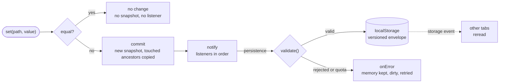
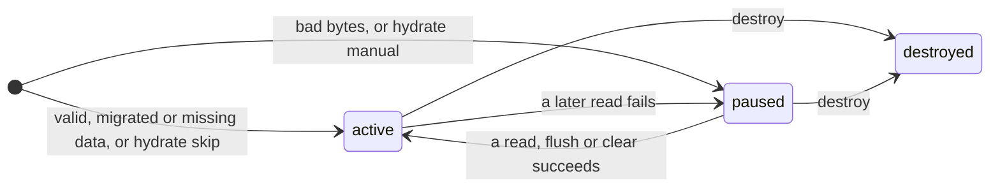

# defuss-store

[](LICENSE)
[](package.json)
[](tsconfig.json)
[](package.json)

**State** that survives the page reload: small synchronous observable stores, zero dependencies.

Path writes, selectors and computed values in a core that touches no browser global, plus optional layers for validated, versioned Web Storage persistence, cross-tab sync and defuss-shadcn State API bindings. ESM with TypeScript declarations, for Node.js and browsers.

## TL;DR

In-memory state is gone after a page reload. Saving it to `localStorage` looks like two calls, `JSON.stringify` and `JSON.parse`, until the stored shape changes between releases, a value no longer parses, or a second tab writes the same key.

defuss-store keeps state in small synchronous stores and persists only the stores you attach persistence to. Every value read from or written to storage goes through your validator, older schema versions go through `migrate()`, bytes it cannot read stay untouched until you recover them on purpose, and `sync: true` picks up writes from other tabs. The core runs unchanged in Node.js, so server code can share store modules with the client.

- ⏱️ **Synchronous, in order:** `set()` has committed state when it returns; listeners run first in, first out
- 🎯 **Path writes and selectors:** `set('items[0].name', value)` copies only the touched ancestors; a selector listener runs only when its selection changes
- 🧮 **Computed values:** read-only stores derived from one or more sources
- ✅ **Validated and versioned:** a validator is mandatory on every read and write; `migrate()` upgrades old schema versions, and its output is validated again
- 🧯 **Bad bytes stay put:** unparsable JSON, a rejected value or a future schema version pauses writes and keeps the stored bytes for explicit recovery
- 🔁 **In sync across tabs:** `sync: true` follows native `storage` events; whole value, last write wins
- 🧩 **defuss-shadcn bindings:** `bindState()` ties a store selection to a component's State API in both directions
- 🪶 **Small and SSR-safe:** zero runtime dependencies, ESM only; importing any entry touches no `window`, `document` or storage

## How it works

A write compares, installs the new snapshot and queues one transition. Listeners drain in order. Attached persistence is one of them, so the value is validated and stored before `set()` returns, and other tabs reread the new bytes from their own `storage` event.



A persistence controller is `paused` or `active` until it is destroyed. A failed read pauses automatic writes until a later read succeeds (`rehydrate()`, or another tab's valid write with `sync: true`) or `flush()` or `clear()` replaces the stored bytes:



| API | When you reach for it | What it does |
|---|---|---|
| **`createStore(initial, options?)`** | state with one owner | Synchronous observable store: root and path writes, selector listeners, ordered notifications, deterministic teardown. |
| **`computed(source, project, options?)`** | derived values | Read-only store, recomputed eagerly when a source changes and destroyed with its sources. |
| **`createWebStorage()`, `createMemoryStorage()`** | a backend for persistence | Lazy `localStorage`/`sessionStorage` with an optional explicit fallback; an isolated in-memory map for tests and servers. |
| **`attachPersistence(store, options)`** | state that must survive a reload | Validated, versioned envelope in storage: migration, hydration modes, explicit recovery, optional cross-tab sync. |
| **`bindState(element, store, options)`** | defuss-shadcn components | Two-way binding between one store selection and a component's State API. |

## Install

```bash
npm install defuss-store
# or: bun add defuss-store
```

As one file in the browser, without a bundler: `dist/browser.js` (and its minified twin `dist/browser.min.js`) bundles every layer and imports nothing, for example from `https://cdn.jsdelivr.net/npm/defuss-store@0.1.0/dist/browser.min.js`.

To try an unreleased build, run `npm run test:package` and install the generated tarball with `npm install artifacts/defuss-store-0.1.0.tgz`.

## Quick Start

```ts
import { createStore, computed } from 'defuss-store';
import { createWebStorage, createMemoryStorage } from 'defuss-store/storage';
import { attachPersistence } from 'defuss-store/persist';

type Prefs = { theme: 'light' | 'dark'; pageSize: number };
const isPrefs = (value: unknown): value is Prefs => {
  const v = value as Partial<Prefs> | null;
  return (v?.theme === 'light' || v?.theme === 'dark') && Number.isSafeInteger(v.pageSize);
};

// 1. A store, and a listener for one field of it
const prefs = createStore<Prefs>({ theme: 'light', pageSize: 20 });
prefs.subscribe(p => p.pageSize, size => console.log('page size', size));

// 2. A derived value
const label = computed(prefs, p => `${p.pageSize} per page`);

// 3. Persistence: saved state is validated and restored before attachPersistence() returns
attachPersistence(prefs, {
  key: 'my-app:prefs', version: 1, validate: isPrefs,
  storage: createWebStorage('local', { fallback: createMemoryStorage() }),
});

prefs.set('pageSize', 50); // committed, logged and stored before this line returns
console.log(label.value);  // 50 per page
```

## API

### `createStore(initial, options?)`

```ts
import { createStore, computed } from 'defuss-store';

const preferences = createStore({ theme: 'system', page: 1 });
const label = computed(preferences, value => `Page ${value.page}`);

const unsubscribe = preferences.subscribe(
  value => value.theme,
  (theme, previous) => console.log({ theme, previous }),
  { immediate: true },
);

preferences.set('theme', 'dark');
preferences.update(current => ({ ...current, page: current.page + 1 }));
console.log(label.value); // Page 2

// Object selections can use an explicit equality function.
const offPage = preferences.subscribe(
  value => ({ page: value.page }),
  value => console.log(value.page),
  { equals: (a, b) => a.page === b.page },
);

unsubscribe();
offPage();
label.destroy();
preferences.destroy();
```

| Member | Behavior |
| --- | --- |
| `createStore(initial, { equals? })` | `Object.is` equality by default; no notification for equal replacements |
| `.value`, `.get()`, `.getRaw()` | Current snapshot, returned by reference |
| `.get('field')` | Known top-level keys retain their TypeScript value type |
| `.get('items[0].name')` | Dynamic paths return `unknown`; own properties only |
| `.set(next)`, `.setRaw(next)` | Replace the root, including `null`/`undefined` when allowed by `T` |
| `.set(path, next)` | Copy the affected ancestors; preserve other references |
| `.set(path, undefined)`, `.remove(path)` | Delete an object property or splice an array index |
| `.update(fn)` | Synchronously replace with `fn(current)` |
| `.reset()`, `.reset(next)` | Restore the initial reference, or replace with the explicit argument |
| `.subscribe(listener, { immediate? })` | Receive `(next, previous, changedPath)`; return an idempotent unsubscribe |
| `.subscribe(selector, listener, { equals?, immediate? })` | Notify only when the selected result changes |
| `.onDestroy(cleanup)` | Register cleanup and receive a cancellation function |
| `.destroy()` | Idempotently release listeners and cleanup; last snapshot remains readable |

**Snapshots:** treat them as immutable; in-place mutation is not observed. `reset()` does not deep-clone the initial value.

**Paths:** plain objects and arrays, dot paths and nonnegative indices (`items.0.name` or `items[0].name`). Empty writes, malformed paths, inherited traversal, and `__proto__`, `prototype` or `constructor` segments are rejected. Dynamic path setters are deliberately not compile-time schema validation; prefer a typed `update` for that. `.get('')` returns the root.

**Notification order:** each committed transition carries its own callback arguments. Reentrant writes commit immediately and their notifications drain FIFO. During an earlier callback, `.value` can therefore already contain a later reentrant value; use the callback's `next` argument for that transition. Removed listeners are skipped; newly subscribed listeners do not receive earlier queued transitions. Listener errors do not stop other listeners or persistence: an `AggregateError` is thrown after the queue drains. There is no rollback or transaction API.

**Equality:** stores use `Object.is` identity equality by default. `jsonEquals` compares `JSON.stringify` results; it is order-sensitive and can throw on non-JSON values.

### `computed(source, project, options?)`

`computed(source, project, { equals? })` and `computed([a, b] as const, (a, b) => result)` return a runtime read-only store.

- The projection runs eagerly and on every source change
- A failing projection keeps the last result and participates in source error reporting
- `.destroy()` detaches early; destroying any source also destroys the derived store
- Multi-source computation is not batched or transactionally glitch-free

Selectors, equality functions, validators and projections should be pure.

### `attachPersistence(store, options)`

```ts
import { createStore } from 'defuss-store';
import { createWebStorage, createMemoryStorage } from 'defuss-store/storage';
import { attachPersistence } from 'defuss-store/persist';

type Preferences = { theme: 'system' | 'light' | 'dark'; page: number };
function isPreferences(value: unknown): value is Preferences {
  if (typeof value !== 'object' || value === null) return false;
  const candidate = value as Record<string, unknown>;
  return typeof candidate.theme === 'string'
    && ['system', 'light', 'dark'].includes(candidate.theme)
    && typeof candidate.page === 'number'
    && Number.isSafeInteger(candidate.page) && candidate.page >= 1;
}

const preferences = createStore<Preferences>({ theme: 'system', page: 1 });
const storage = createWebStorage('local', { fallback: createMemoryStorage() });
const persistence = attachPersistence(preferences, {
  key: 'my-app:preferences', storage, version: 1,
  validate: isPreferences,
  onError: failure => console.error(failure.operation, failure.error),
});

// Existing validated state has already been restored. No eager default write.
preferences.set('theme', 'dark'); // Persists synchronously.
persistence.clear();             // Removes this key; keeps state in memory.
persistence.flush();             // Explicitly saves the current snapshot.
preferences.destroy();          // Also disposes persistence.
```

The stored format is `{ "format": "defuss-store", "formatVersion": 1, "version": 1, "value": ... }`.

#### `PersistenceOptions<T>`

| Option | Type | Default | Description |
|---|---|---|---|
| `key` | `string` | required | Storage key; empty strings are supported |
| `storage` | `StorageBackend` | required | Synchronous string backend, see [storage](#storage-backends) |
| `version` | `number` | required | Application schema version, a nonnegative safe integer |
| `validate` | `(value) => value is T` | required | Type guard applied to state on every read and write |
| `migrate` | `(oldValue, fromVersion) => unknown` | - | Maps an older schema to the current one; the output is validated |
| `legacyVersion` | `number` | - | Schema version of raw JSON written by the old defuss store |
| `codec` | `{ encode, decode }` | `jsonCodec` | Serializer for the whole envelope |
| `hydrate` | `'immediate' \| 'manual' \| 'skip'` | `'immediate'` | When storage is read, see below |
| `sync` | `boolean` | `false` | Reread on remote invalidation such as native `storage` events |
| `onError` | `(failure) => void` | `console.error` | Receives every operational failure |

#### Controller

| Hydration mode or method | Contract |
| --- | --- |
| `hydrate: 'immediate'` (default) | Read and validate before enabling automatic writes |
| `hydrate: 'manual'` | Pause writes and remote hydration until `rehydrate()`, `flush()`, or `clear()` |
| `hydrate: 'skip'` | Enable writes without reading; no write until a change or `flush()` |
| `rehydrate()` | Read again; saved state wins; a missing key preserves current memory |
| `flush()` | Validate and save current memory; explicitly recovers paused persistence |
| `clear()` | Remove only this key; next real mutation may recreate it |
| `status()` | Snapshot of `phase`, `dirty`, last observed `hasStoredValue`, and optional `lastError` |
| `destroy()` | Unsubscribe without writing or deleting; never flushes implicitly |

The three operational methods return `true` on success and `false` on reported operational failure. Using a destroyed controller throws. Only one persistence controller may own a store at a time; dispose it before attaching another.

**Failure and recovery:** missing data never overwrites memory. Invalid JSON, invalid state, migration errors, unsupported envelopes and future schema versions pause automatic writes and preserve the original bytes. Recovery is explicit: fix storage and `rehydrate()`, replace it with `flush()`, or remove it with `clear()`. Write and quota errors retain committed memory, mark it dirty, and report through `onError`; the next mutation or `flush()` retries. These are not listener rollback semantics.

#### Migration and serialization

Provide `migrate(oldValue, fromVersion)` when reading an older application schema. It must return the **current** schema; use sequential migrations inside that function for multiple old versions. Its output is validated. A migrated value stays dirty until an explicit flush or a local change; hydration does not rewrite storage.

To import the old defuss store's raw JSON, set `legacyVersion` to the schema version of that data. If it matches the current version, validation is sufficient; otherwise `migrate` is required. Legacy bytes are preserved until the next write, which uses the envelope. Future versions are never downgraded automatically.

The default `jsonCodec` checks the entire envelope before serialization. It accepts JSON primitives, plain records, and dense arrays. It rejects cyclic references, `undefined`, `BigInt`, functions, symbols, dates, maps, non-finite numbers, negative zero, accessors, hidden properties, and sparse or extended arrays instead of silently losing information. Shared acyclic values are supported, but reference identity and null prototypes are not preserved by JSON. A custom `codec: { encode(value): string, decode(bytes): unknown }` can implement other formats; it processes the whole envelope and still passes decoded state through validation.

### Storage backends

`createMemoryStorage()` makes a fresh, isolated map every time. Share the same instance deliberately if stores need the same backing data. It implements `getItem`, `setItem`, `removeItem`, `clear`, `key`, and `length`, but does not broadcast changes.

`createWebStorage('local' | 'session', { fallback?, onUnavailable? })` lazily acquires browser storage on first use, so import is safe in SSR. A supplied fallback is selected only if acquiring storage fails; it stays selected for that adapter. A quota or later I/O failure does not silently switch backends. A fallback is optional and must be explicitly provided.

The raw backend interface is synchronous and DOM-free:

```ts
interface StorageBackend {
  getItem(key: string): string | null;
  setItem(key: string, value: string): void;
  removeItem(key: string): void;
  subscribe?(listener: (change: { key: string | null }) => void): () => void;
}
```

#### Cross-tab synchronization

Use `sync: true` with native Web Storage to consume its `storage` events. Only the selected storage area and key are handled. The adapter rereads current bytes and hydration never echoes a remote write. Removal or clear preserves in-memory state and records that storage is absent.

- `localStorage` synchronizes across same-origin documents; `sessionStorage` follows the browser's top-level browsing-context rules
- Native events do not notify the writer or another store in the same document: share one store for same-page state
- This is whole-value last-write-wins synchronization, with no cross-tab atomic update, merge, or CRDT guarantee

`sync: true` requires a backend with `subscribe`. A plain memory fallback has no such capability: use persistence without sync, or supply a custom backend implementing remote invalidation.

### `bindState(element, store, options)`

Initialize the component normally with defuss-shadcn, then bind its existing `element.api`. The package does not install `df$` or import shadcn. A selector lets several components share one preferences object without overwriting each other's fields.

```ts
import { bindState, type ComponentApi } from 'defuss-store/bind';
import { createStore } from 'defuss-store';

const preferences = createStore({ tabId: 'account', page: 1 });
const tabs = document.querySelector<HTMLElement & { api: ComponentApi }>('#tabs')!;
const abort = new AbortController();
const binding = bindState(tabs, preferences, {
  select: value => value.tabId,
  toState: id => ({ name: 'active', config: { id } }),
  fromState: (state, current) => ({ ...current, tabId: String(state.config.id) }),
  signal: abort.signal,
});

preferences.set('tabId', 'billing'); // Component follows the store.
// Component clicks, keyboard actions and api.setState update the store.
abort.abort(); // Or binding(); both release everything idempotently.
```

Store state wins on mounting by default; set `initial: 'element'` to read the component first. Attach persistence before binding if restored preferences should initialize the UI. Rejected or clamped component requests are normalized back into the store (for example, disabled tabs or an out-of-range page).

The binding observes DOM mutations and component events, and wraps the existing `api.setState`. API calls are observed synchronously; event and attribute observations are coalesced into a microtask. It restores the original method and removes all observers and listeners on disposal, abort, or store destruction. Only one binding per element is allowed. Applications own the lifecycle: removing a DOM element alone does not dispose its binding.

| Option | Description |
|---|---|
| `select`, `toState`, `fromState` | Required: the store slice, its component state, and the next store value from a component state |
| `equals` | Compares selected values; `Object.is` by default |
| `initial` | `'store'` (default) or `'element'`: which side wins on mounting |
| `events` | Adds component-specific events |
| `observe` | `false` disables the mutation observer |
| `sources` | Filters observed `user`, `api`, `attribute`, and `layout` sources |
| `signal` | An `AbortSignal` that disposes the binding |
| `onError` | Handles asynchronous observation failures |

`shadcn:statechange` events may supply `{ source }` in `detail`. Sources describe the observation mechanism, not a universally precise causal classification of legacy components. A registry-only configuration change with no DOM or event signal requires `binding.pull()`; `binding.push()` reapplies the current store selection.

The browser tests use pinned, unmodified upstream core, tabs, pagination, and sidebar JavaScript, not mocked component implementations. See `tests/fixtures/components.html` for complete working mappings. Other State API components can use the same adapter but require their own field mapping and integration validation.

### Package entries and SSR

Create stores and memory storage per request. Never export a mutable user store from a server module singleton. All entries can be imported without acquiring browser globals, and core, storage and persistence declarations typecheck without DOM libraries. Only using the optional binding requires DOM types and an initialized element.

Each size is the entry bundled alone and minified, so shared chunks count toward every entry that uses them; gzip is that bundle compressed. `npm run build` measures them into `dist/stats.json`.

| Import | Contents | Minified | Gzip |
| --- | --- | ---: | ---: |
| `defuss-store` | Core, computed, equality helpers and store types | 3,913 B | 1,853 B |
| `defuss-store/storage` | Raw storage adapters, strict JSON codec and types | 2,258 B | 1,095 B |
| `defuss-store/persist` | Validated, versioned persistence and types | 4,730 B | 1,972 B |
| `defuss-store/bind` | Optional State API binding and types | 2,058 B | 1,048 B |
| `defuss-store/browser` | Standalone browser ESM with core, storage, persist and bind | 11,582 B | 4,702 B |

`dist/browser.js` and `dist/browser.min.js` are direct browser modules with source maps; the latter is a physical asset rather than a separate package import. Root imports do not pull in optional layers.

## How it scales

`make bench` times one operation of the built `dist/` while its input grows. Each figure is the median of 15 timings from the committed snapshot `docs/assets/bench.json`, measured on Apple M4 (darwin arm64), Node.js v24.14.0, 2026-10-10. The numbers describe that machine, not yours. Growth is the slope of log time over log size across the larger half of the sizes: flat below 0.25, linear from 0.75 to 1.3.

| Operation | Input grows | Smallest input | Largest input | Growth |
| --- | --- | ---: | ---: | --- |
| `get(path)` | 1 to 256 path segments | 35.8 ns | 11.5 µs | linear |
| `set(path, value)` | 1 to 256 path segments | 95.5 ns | 26.0 µs | linear |
| `get(items[last].text)` | 10 to 100,000 list items | 130 ns | 139 ns | flat |
| `set(items[last].text, value)` | 10 to 100,000 list items | 301 ns | 90.4 µs | linear |
| `set(…)` + persistence to memory storage | 10 to 100,000 list items | 4.0 µs | 34.2 ms | linear |
| `set()` calls every listener | 1 to 10,000 subscribers | 65.2 ns | 76.4 µs | linear |
| `set()` with selectors, one selection changes | 1 to 10,000 subscribers | 179 ns | 108 µs | linear |

A path is parsed and walked segment by segment, a write copies each object and array on its path, and a commit visits every subscriber. Each cost therefore grows with what it touches: reading the last list item stays flat because the read walks three segments whatever the list length. Persistence encodes the whole stored value on every write, so its cost follows the stored size. The [docs site](https://store.defuss.org) charts every measured point.

## When to use it

### DO: use it for

- **Preferences and UI state that must survive a reload:** theme, open tab, page size, form drafts
- **Stored data whose shape changes between releases:** bump `version` and migrate on read
- **State that several components on one page read:** one store, a selector listener per component
- **defuss-shadcn components:** bind a component's State API to a persisted store
- **Server rendering:** a store per request; no entry touches browser globals on import

### DON'T: use it for

- **Large, fast-changing persisted lists:** every write encodes the whole value (see [How it scales](#how-it-scales)); keep them in a store without persistence, or split them
- **Edits in several tabs that must merge:** sync is whole-value last-write-wins, without atomic read-modify-write across tabs
- **Updates that must commit or roll back together:** there is no transaction API
- **CommonJS or legacy browsers:** they are not targeted

### Key principles

1. **Treat snapshots as immutable.** Write through `set`, `update` or `remove`; in-place mutation is not observed.

2. **The validator is the contract.** It runs on every read and write and decides what may enter storage and what may come back out. Keep it, and every selector, equality function and projection, pure.

3. **Attach persistence before binding.** The restored preferences are then what the component mounts with.

4. **Recover on purpose.** Automatic writes never overwrite bytes that failed to read: decide whether to fix them and `rehydrate()`, replace them with `flush()` or remove them with `clear()`. `status().lastError` and `onError` report why persistence paused.

5. **One store per request on the server.** Never export a mutable user store from a server module.

## Patterns

### Schema migration

```ts
import { createStore } from 'defuss-store';
import { createMemoryStorage, createWebStorage } from 'defuss-store/storage';
import { attachPersistence } from 'defuss-store/persist';

// v1 stored { dark: boolean }; v2 stores { theme: 'light' | 'dark' | 'system' }.
type Settings = { theme: 'light' | 'dark' | 'system' };
const isSettings = (v: unknown): v is Settings =>
  ['light', 'dark', 'system'].includes((v as Partial<Settings> | null)?.theme as string);

const settings = createStore<Settings>({ theme: 'system' });
const persistence = attachPersistence(settings, {
  key: 'my-app:settings', version: 2, validate: isSettings,
  storage: createWebStorage('local', { fallback: createMemoryStorage() }),
  migrate: (old, fromVersion) => fromVersion === 1 && (old as { dark?: unknown }).dark === true
    ? { theme: 'dark' } : { theme: 'system' },
  onError: (failure) => console.warn(failure.operation, failure.error),
});
persistence.status(); // { phase: 'active', dirty: true, hasStoredValue: true } after a v1 → v2 migration
```

### Selectors and computed values

```ts
import { computed, createStore, jsonEquals } from 'defuss-store';

const cart = createStore({ items: [{ sku: 'a', qty: 1, price: 12 }], coupon: '' });
const total = computed(cart, (c) => c.items.reduce((sum, i) => sum + i.qty * i.price, 0));

// A selector listener runs only when its selection changes.
cart.subscribe((c) => c.items.length, (count) => console.log('items', count));
// Object selections need an explicit equality.
cart.subscribe((c) => ({ coupon: c.coupon }), (s) => console.log(s.coupon), { equals: jsonEquals });

cart.set('items[0].qty', 3);  // copies items and items[0]; coupon keeps its reference
total.value;                    // 36
cart.remove('items[0]');        // splices the array → 'items' 0
```

### Browser module without a bundler

```html
<button>Clicked <output>0</output> times</button>
<script type="module">
  import { attachPersistence, createStore, createWebStorage }
    from 'https://cdn.jsdelivr.net/npm/defuss-store@0.1.0/dist/browser.min.js';

  const clicks = createStore(0);
  attachPersistence(clicks, {
    key: 'clicks', version: 1, storage: createWebStorage('local'),
    validate: (value) => Number.isSafeInteger(value),
  });
  clicks.subscribe((n) => { document.querySelector('output').value = n; }, { immediate: true });
  document.querySelector('button').onclick = () => clicks.update((n) => n + 1);
</script>
```

### One store per server request

```ts
import { computed, createStore } from 'defuss-store';

// Importing defuss-store touches no window, document or storage, so server code can share modules with the client.
export function renderGreeting(user: { name: string; unread: number }) {
  // One store per request: never export a mutable user store from a module.
  const session = createStore(user);
  const label = computed(session, (s) => `${s.name}: ${s.unread} unread`);
  const text = label.value;
  session.destroy(); // also destroys the computed store
  return text;
}
```

## What "verified" means

`make verify` runs these suites, the same target CI runs on Node.js 22 and 24:

- `make test` runs the unit tests in Node.js without DOM mocks: paths, notifications, computed stores, storage, codec, persistence and the docs site's pure demo and chart logic
- `make typecheck` checks the sources and the public API type tests in `tests/types`
- `make coverage` writes V8 unit coverage; binding code is excluded there because the browser suite exercises it
- `npm run test:browser` drives the built entries in real Chromium with Playwright: native Web Storage, two-page sync, bindings to pinned upstream defuss-shadcn components, and the docs site
- `npm run test:package` installs the packed tarball outside the repository and checks runtime imports, SSR isolation, declarations under NodeNext and Bundler resolution, DOM-free server types and browser bundling
- `npm run verify` checks package metadata, exports, fixture integrity and layer isolation, and compares every size and scaling row in this README with `dist/stats.json` and `docs/assets/bench.json`

```sh
npm ci
npx playwright install --with-deps chromium
npm run check
```

`check` runs lint, type checks, the build, unit coverage, the browser tests, the packed-consumer install and `verify`, and writes the publishable `.tgz` and `artifacts/package-verification.json`. `npm publish` runs it through `prepublishOnly`. To use an existing Chromium, set `PLAYWRIGHT_CHROMIUM_EXECUTABLE_PATH`.

`npm run dev` serves the browser example at `http://127.0.0.1:4178` after a build, and the docs site at `/docs/` on the same server; local browser test runs reuse that server, CI starts its own. `docs/` is the static GitHub Pages site for store.defuss.org: `npm run build` copies `dist/browser.js` into it, `tests/e2e/docs.spec.ts` drives it, and `npm run verify` fails when its sizes, coverage figures, version, served bundle or code excerpts differ from the build. `make bench` builds, runs the fixed-size benchmarks of `src/` and then the scaling benchmark of `dist/`, which writes `output/bench-scaling.json`; `npm run bench:scaling -- --out docs/assets/bench.json` refreshes the committed snapshot. Neither has performance thresholds. Browser reports land in `output/`.

### Deliberate limits

No rollback or transactions, no glitch-free batching of multi-source computed stores, no deep clone in `reset()`, no compile-time validation of dynamic paths, no cross-tab merge or CRDT. One persistence controller per store, one binding per element, and removing an element does not dispose its binding. Internals are described in [ARCH.md](ARCH.md), history in [CHANGELOG.md](CHANGELOG.md), and the provenance of the vendored browser fixtures in `tests/fixtures/vendor/provenance.json`.

## Requirements

- **Node.js** 22.12 or later; CI runs Node.js 22 and 24
- **Browsers** with ES2022 support; ESM only
- **TypeScript** declarations ship with every entry; those of the core, storage and persistence typecheck without the DOM library

## Citation

If you use defuss-store in research or want to reference it, cite it as:

```bibtex
@misc{homberg2026defussstore,
  author       = {Homberg, Aron},
  affiliation  = {Independent Researcher},
  title        = {defuss-store: Synchronous Observable Stores with Validated, Versioned Web Storage Persistence for JavaScript},
  year         = {2026},
  version      = {0.1.0},
  howpublished = {\url{https://www.npmjs.com/package/defuss-store}},
  note         = {npm package, MIT License}
}
```

## License

MIT, see [LICENSE](LICENSE).
